# 01：堆内存溢出 (Java heap space) 排查实录

> **实验环境**：OpenJDK 21 (Azul Zulu 21.0.13) | **默认 GC**：G1 | **核心工具**：`jcmd`、Unified GC Logging (`-Xlog`)、Eclipse MAT
## 1. 故障现象
应用运行一段时间后，业务接口响应延迟明显升高（频繁触发 GC 导致应用线程停顿 STW），监控显示老年代内存占用呈锯齿状持续攀升且每次 GC 后几乎无法回落，最终进程抛出 `java.lang.OutOfMemoryError: Java heap space` 异常崩溃。

---

## 2. 复现步骤

### 2.1 编写故障模拟代码
模拟高并发业务中常见的**无界本地缓存**缺陷：静态集合持续缓存业务大对象，且未设置容量上限与过期淘汰策略。

```java
import java.time.Duration;
import java.util.ArrayList;
import java.util.List;

/**
 * 模拟场景：本地静态缓存缺乏容量上限与淘汰机制，对象持续晋升老年代触发 Java heap space
 * 适用环境：JDK 17 / JDK 21 (G1 GC)
 */
public class HeapOomDemo {

    // 模拟无淘汰机制的本地静态缓存（GC Roots 强引用持有，无法被回收）
    private static final List<OrderCachePayload> LOCAL_CACHE = new ArrayList<>();

    static class OrderCachePayload {
        private final long orderId;
        // 每个对象分配 256KB（避开 G1 默认 1MB Region 的大对象阈值，模拟正常分代晋升）
        private final byte[] payload = new byte[256 * 1024];

        public OrderCachePayload(long orderId) {
            this.orderId = orderId;
        }
    }

    public static void main(String[] args) throws InterruptedException {
        long pid = ProcessHandle.current().pid();
        System.out.println("============================================================");
        System.out.println("HeapOomDemo 已启动 | 当前进程 PID: " + pid);
        System.out.println("请在终端 B 执行: jcmd " + pid + " GC.heap_info");
        System.out.println("============================================================");

        long count = 0;
        while (true) {
            count++;
            LOCAL_CACHE.add(new OrderCachePayload(count));
            if (count % 10 == 0) {
                System.out.printf("[运行监控] 已缓存对象数: %d | 预计占用堆内存: ~%.1f MB%n",
                        count, (count * 256.0) / 1024);
            }
            // 每 80ms 分配 256KB（约 3.1MB/s），在 -Xmx64m 下约 18 秒触发 OOM，留足在线排查窗口
            Thread.sleep(Duration.ofMillis(80));
        }
    }
}
```

### 2.2 启动服务并采集监控（双终端操作）
打开 **终端窗口 A**，编译并将初始堆与最大堆均限制为 `64MB` 运行（开启 OOM 自动导出堆快照及 JDK 9+ 统一格式 GC 日志）：

```bash

cd ~/github-labs/java-troubleshooting-labs/01-heap-oom
javac HeapOomDemo.java

java -Xms64m -Xmx64m \
     -XX:+HeapDumpOnOutOfMemoryError \
     -XX:HeapDumpPath=./heap_oom.hprof \
     "-Xlog:gc*:file=./gc.log:time,uptime,level,tags" \
     HeapOomDemo
```

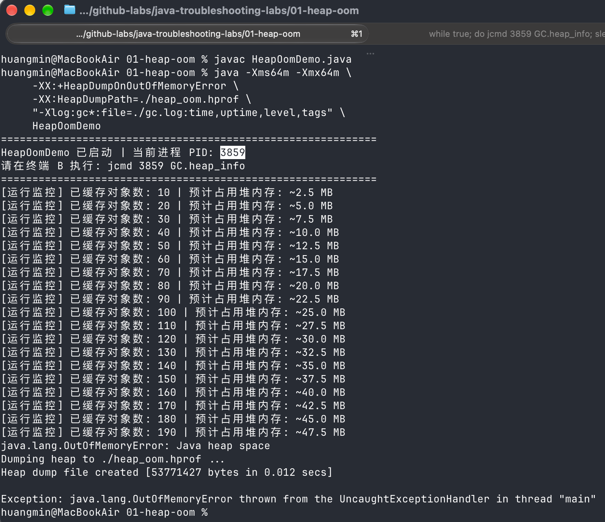

进程触发 OOM 崩溃后，当前目录下已自动生成堆内存快照 `heap_oom.hprof` 与 GC 日志 `gc.log`。由于快照为二进制镜像文件，无法在文本编辑器中直接查看，后续将使用 **Eclipse MAT** 进行离线分析：

立即切换到 **终端窗口 B**，使用 JDK 官方多合一诊断工具 `jcmd` 获取目标进程 PID（替代传统的 `jps`）：

```bash
jcmd 
# 输出示例：45812 HeapOomDemo
```

---

## 3. 排查与根因定位

### 第一步：`jcmd` 实时观察堆内存趋势（替代传统 `jstat`）
> **工具选型说明**：在 JDK 17/21 生产环境中，G1 垃圾回收器的内存分区（Region）会动态扩缩容，传统的 `jstat -gcutil` 容易因分母动态变化导致老年代占比失真（ZGC 下甚至无法显示分代数据）。本实验统一使用 `jcmd` 观察真实内存分配。

在终端 B 中每秒刷新一次 G1 堆内存与元空间占用（将 `<PID>` 替换为实际进程号）：

```bash
while true; do jcmd <PID> GC.heap_info; sleep 1; done
```

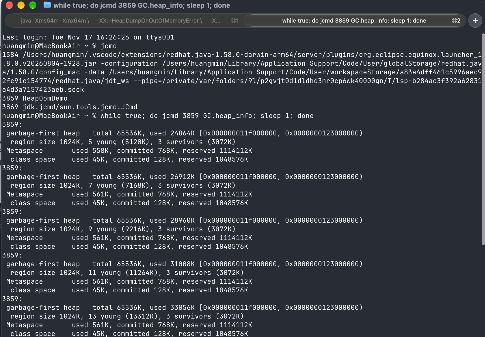


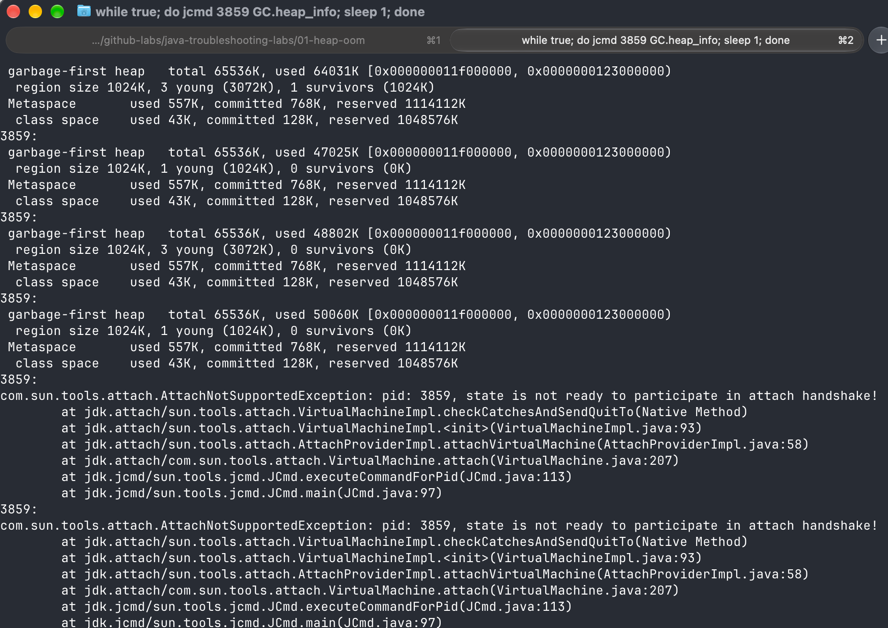


**关键指标研判**：

- `garbage-first heap total 65536K, used 64031K`：堆总容量 64MB，已用空间在十几秒内快速逼近上限；即便触发 Full GC 也仅能回落至 `47025K ~ 50060K`（约 48MB 老年代强引用完全无法释放），随后进程因 OOM 崩溃退出（终端报错 `AttachNotSupportedException`）。
- `region size 1024K, 1 young (1024K), 0 survivors (0K)`：新生代空间被极度压缩，大量对象不断晋升至老年代，初步判定存在**内存泄漏（强引用对象无法回收）**或**堆内存配置过小**。

### 第二步：`jcmd` 在线类直方图秒级定位大对象（替代传统 `jmap -histo`）
在分析庞大的 `.hprof` 离线文件前，先通过 `jcmd` 在线统计堆内对象分布，快速锁定嫌疑类：

```bash
jcmd <PID> GC.class_histogram -all | head -n 15
```

> **生产避坑指南**：执行 `GC.class_histogram` 时**务必加上 `-all` 参数**。若省略 `-all`，JVM 为了只统计“存活对象”会**主动触发一次 Full GC**，在内存本就濒临枯竭的生产云主机上极易引发长时间业务卡顿（STW）。

**终端输出关键片段**：
```text
 num     #instances         #bytes  class name (module)
-------------------------------------------------------
   1:           9361       18486288  [B (java.base@21.0.13)
```
- 如下图所示：

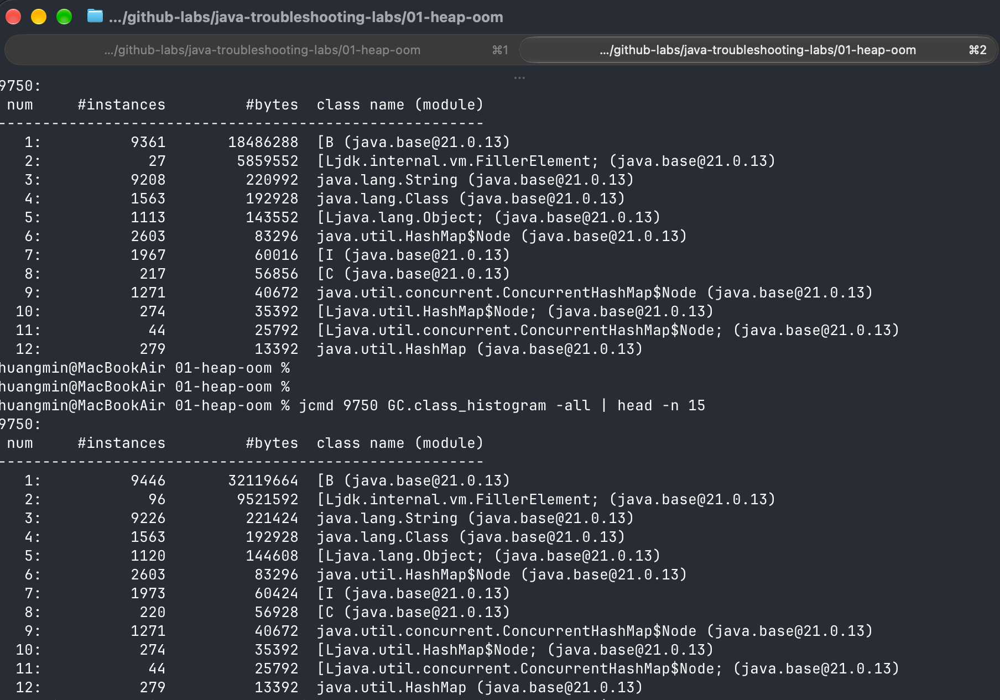


**初步结论与原理剖析**：
- **现象归因**：字节数组 `[B` 占据了绝大部分堆空间（运行中采样已达 `32.1MB`，崩溃前突破 `53.7MB` / 占总堆 83% 以上），与业务对象 `HeapOomDemo$OrderCachePayload` 内部持有的 `256KB` 缓冲区直接对应。
- **为什么榜首是 `[B` 而非业务类 `OrderCachePayload`？**
  - 在 JVM 类型签名中，`[` 代表一维数组，`B` 代表基本类型 `byte`，即 `byte[]`。
  - 在 HotSpot 堆内存中，`OrderCachePayload` 实例与内部的 `byte[]` 是**分离存储的两个独立对象**：`OrderCachePayload` 自身仅保存对象头（12B）、`long orderId`（8B）及数组引用指针（4B），**浅堆（Shallow Heap）仅 24 Bytes**；真正承载 `256KB`（`262,160 Bytes`）数据的数组对象全部归入 `[B` 名下。由于 `GC.class_histogram` 按**浅堆**汇总，上百个业务外壳总计仅 `2~3KB`（无法进入 `head -n 15`），从而呈现出“只见 `[B` 不见业务类”的现象。
- **实战排查权衡（本步的价值与局限）**：
  - **生产必要性（低成本秒级定性）**：线上服务堆内存动辄 4G~16G，导出、下载并用 MAT 解析 `.hprof` 往往耗时十几分钟；而 `jcmd` 直方图可在 **1 秒内低成本出结果**，看到 `[B` 暴涨即可迅速将代码排查范围收敛到**二进制缓存、文件流读写、Excel 导出或大字段 SQL 查询**等高危场景，并与后续离线快照形成动态/静态数据交叉印证。
  - **手段局限性（为何必须接第三步 MAT）**：类直方图**不包含对象引用链（GC Roots）与分配调用栈**。在真实微服务中，Netty、MyBatis、JSON 序列化等组件都会高频创建 `byte[]`，仅靠类型分布无法定位具体代码行，因此必须借助下一步的 **Eclipse MAT** 追踪引用链锁定持有者（若线上严禁 Dump 快照，也可使用 Arthas / Async-Profiler 的 `alloc` 内存分配采样直接抓取分配堆栈）。

### 第三步：Eclipse MAT 离线分析堆转储文件 (`heap_oom.hprof`)
进程触发 OOM 崩溃后，当前目录下自动生成了 `heap_oom.hprof`。
*(注：若线上服务尚未崩溃但内存持续告警，需手动执行 `jcmd <PID> GC.heap_dump ./heap_manual.hprof` 导出快照；**执行前必须先在 SLB/Nacos 摘除该节点流量**，避免写磁盘触发的 STW 导致请求超时雪崩。)*

1. 打开 **Eclipse MAT** -> `File` -> `Open Heap Dump...` -> 选择 `heap_oom.hprof`。
2. 弹出向导选择 **Leak Suspects Report（内存泄漏嫌疑报告）**，快速确认占用 **97.58%** 内存的嫌疑对象。
3. 切换至 **Dominator Tree（支配树）** 视图，按 **`Retained Heap`（深堆）** 降序排列：
   - *Shallow Heap（浅堆）*：对象自身占用的内存大小（不含其引用的其他对象）。
   - *Retained Heap（深堆）*：回收该对象后**总共能释放的内存总和**（排查内存泄漏的核心指标）。
   - 发现 `java.util.ArrayList`（及其内部存储数组 `elementData java.lang.Object[244]`）的 `Retained Heap` 高达 **`49,815,976` bytes（精确占比 `97.58%`）**，内部实际持有 **190 个** `HeapOomDemo$OrderCachePayload` 实例。
     > **数据交叉印证**：`elementData` 净深堆 `(49,815,952 - 992) ÷ 262,184 B/条 = 190 条`（单条含 24B 对象外壳 + 262,160B 字节数组），与第 2.2 节终端崩溃前打印的 `已缓存对象数: 190` 严格一致；数组长度 `244` 则为 `ArrayList` 经 1.5 倍扩容后的槽位数（实际有效元素 190 个，空闲 54 槽）。
1. 右键该 `Object[]` -> **Path To GC Roots -> exclude all phantom/weak/soft etc. references**（排除虚/弱/软引用，仅追踪强引用链）：
   - 追踪到最终的 GC Root 为 `HeapOomDemo` 类的静态字段 **`LOCAL_CACHE`**。
- 截图如下所示：

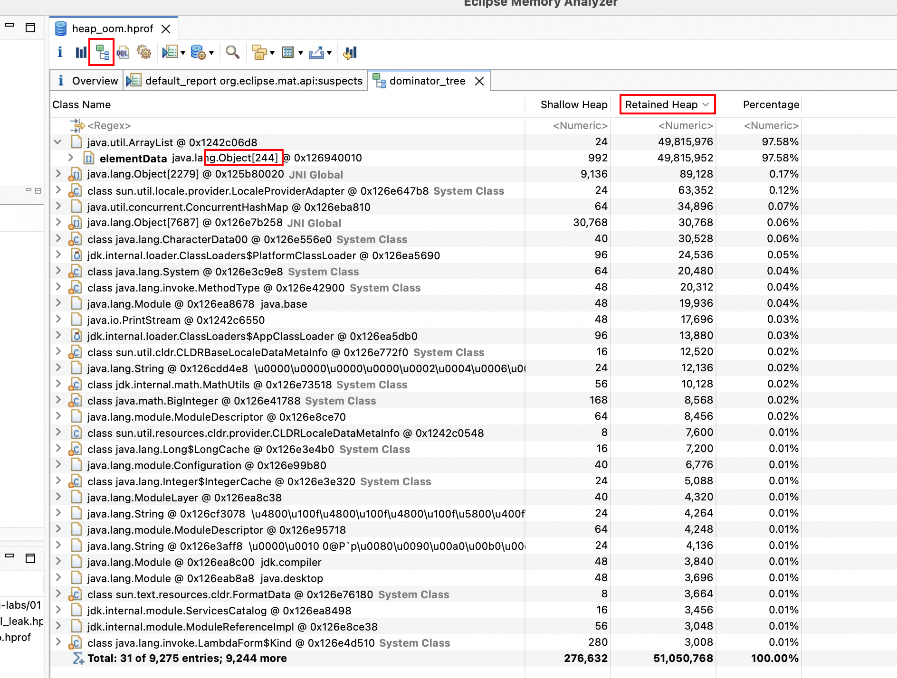

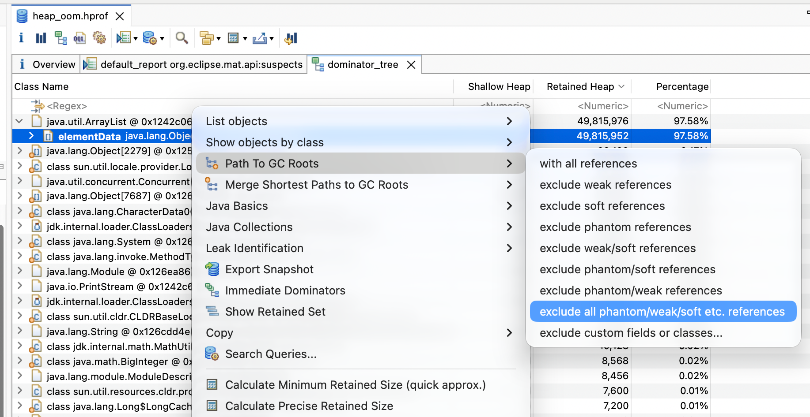

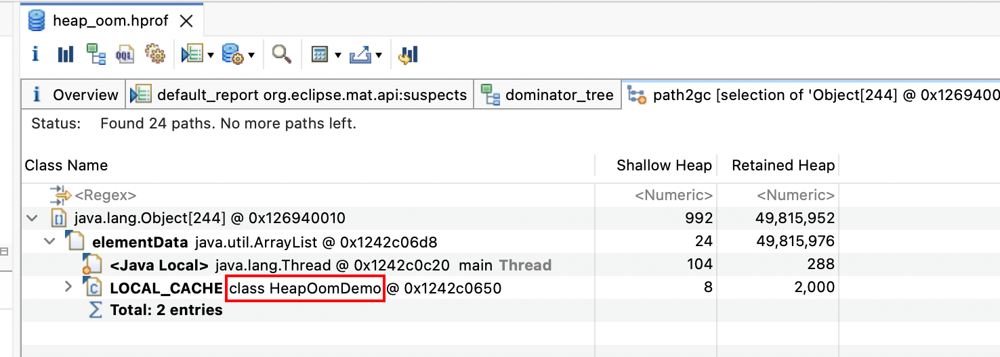

### 根因定位结论
`HeapOomDemo.LOCAL_CACHE` 作为静态集合被 GC Roots 长期强引用，业务代码持续向其中写入 `OrderCachePayload`（单条 256KB）且缺乏容量上限与过期淘汰机制，导致老年代被彻底填满，最终触发 `Java heap space`。

---

## 4. 解决方案与修复验证

### 4.1 治理方案

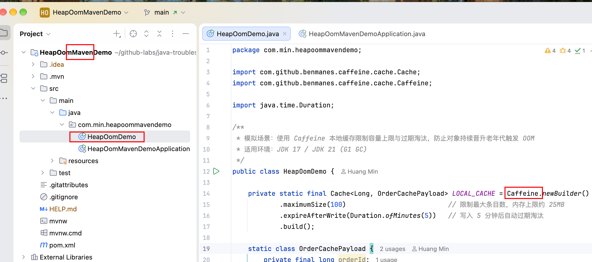

1. **代码层（治本）**：
   - **技术选型与版本说明**：本地缓存严禁直接使用无界 `HashMap` / `ArrayList`。本实战使用maven项目，基于 JDK 21 环境，引入适配 JDK 11+ 的高性能本地缓存组件 **Caffeine 3.x**（`com.github.ben-manes.caffeine:caffeine:3.3.1`），替代原有的无界静态集合。
   - **核心修改点说明**：
     1. **替换无界容器**：将原有的 `private static final List<OrderCachePayload> LOCAL_CACHE` 替换为线程安全的 `Cache<Long, OrderCachePayload>`，写入方式由 `LOCAL_CACHE.add(...)` 改为 `LOCAL_CACHE.put(count, ...)`。
     2. **建立双重淘汰策略**：配置 `maximumSize(100)` 严格限制最大缓存条目数（基于 W-TinyLFU 算法自动驱逐冷数据，将缓存数据内存锁死在约 25MB 安全阈值内），同时配置 `expireAfterWrite(Duration.ofMinutes(5))` 设定写入后自动过期时间，防止僵尸数据长期滞留老年代。
     3. **监控指标改造**：通过 `LOCAL_CACHE.estimatedSize()` 实时观测当前有效缓存条目数，验证淘汰机制是否生效。
     ```java
     // 替换原有的 static final List<OrderCachePayload> LOCAL_CACHE
     private static final Cache<Long, OrderCachePayload> LOCAL_CACHE = Caffeine.newBuilder()
             .maximumSize(100)                          // 限制最大条目数，内存上限约 25MB
             .expireAfterWrite(Duration.ofMinutes(5))   // 写入 5 分钟后自动过期淘汰
             .build();
     ```
   - **排查大对象瞬时堆积**：检查数据库访问层是否存在未分页的全量查询（`SELECT *`）或一次性在内存中构建百万行 Excel 报表的逻辑，改为游标分页或流式导出。

2. **参数与云运维层（治标与兜底）**：
   - 评估业务正常水位后合理设置 `-Xms` 与 `-Xmx`（生产环境通常设为一致，避免堆动态扩缩容引发内存震荡）。
   - 生产启动参数务必保留 `-XX:+HeapDumpOnOutOfMemoryError`，在容器（K8s）或云主机环境下需将 `-XX:HeapDumpPath` 指向挂载的**持久化存储卷（NAS / PVC / 独立数据盘）**，防止实例重启后丢失故障现场。

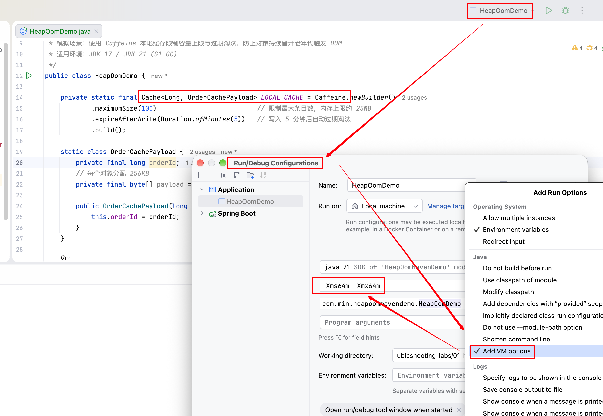

### 4.2 修复后回归验证


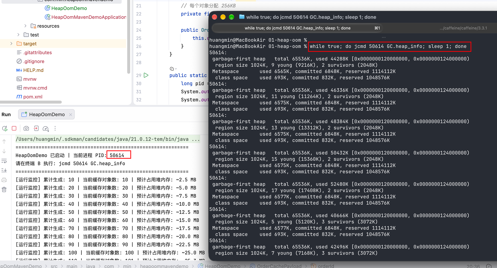

将本地缓存替换为上述 Caffeine 配置（最大容量 100 条 + 5 分钟写入过期）后，在 IDEA 中配置 `-Xms64m -Xmx64m` VM 参数重新启动压测（进程 PID `50614`），并通过终端持续执行 `jcmd 50614 GC.heap_info` 或执行`while true; do jcmd <PID> GC.heap_info; sleep 1; done`观察内存变化：

- **缓存容量严格受控**：控制台监控显示，即使累计生成对象超过 **1,160 个**（远超改造前 190 个即崩溃的阈值），受 Caffeine 容量淘汰策略控制，当前缓存对象数始终稳定在 **100 ~ 101 个**，缓存数据占用锁死在 **~25.0 MB ~ 25.3 MB**。
- **堆内存呈健康锯齿状波动**：`jcmd` 监控显示整体堆内存使用量稳定维持在 **40MB ~ 58MB（`40,666K ~ 59,648K`）** 区间——每次年轻代从 `2 ~ 5 young` 增长至 `17 ~ 18 young（约 18MB）` 后，触发正常的 **Young GC** 将被淘汰对象彻底回收，总堆占用随即回落至 `40MB ~ 44MB` 左右，老年代水位不再持续攀升，服务持续稳定运行无 OOM 异常。


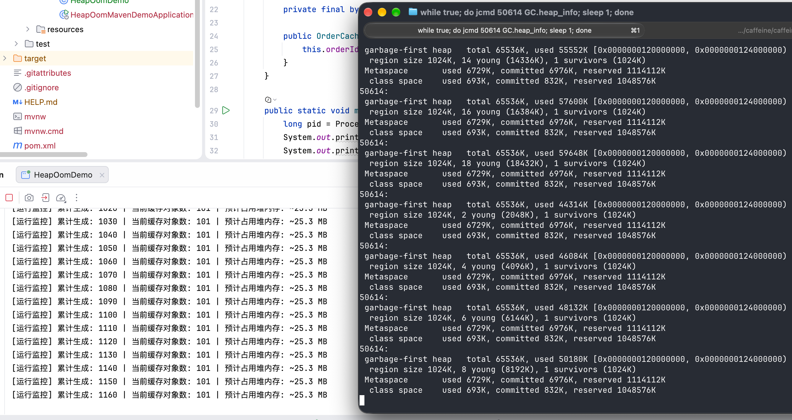


---

## 附录：实验目录结构
- `HeapOomDemo.java`：故障复现单文件（纯 JDK 原生实现，无需外部依赖，模拟无界 `ArrayList` 静态缓存引发 `Java heap space`）。
- `HeapOomMavenDemo/`：修复验证工程（标准 Maven 项目，引入 `Caffeine 3.3.1` 依赖，演示基于容量上限与过期策略的本地缓存治理方案）。
- `assets/`：排查过程终端监控与 Eclipse MAT 堆快照分析截图。